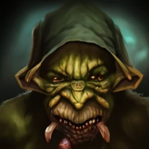
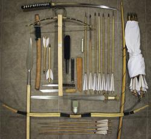
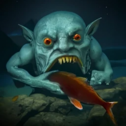
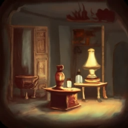
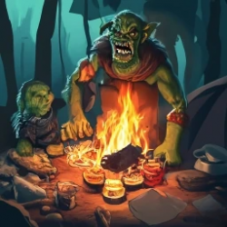

# OpenGameArt: sound effects

**105 assets from [OpenGameArt](https://opengameart.org), dedicated to the public domain under [CC0](https://creativecommons.org/publicdomain/zero/1.0/).** Use them in any game, free or paid, and change them however you like; no credit is needed.

Sound effects from OpenGameArt entries licensed CC0 (some also offer other licences; CC0 is the one that applies here). 1.1 GB in all.

This is a copy kept by [zuujis-cc0](https://github.com/zuujis-cc0) so game makers can take single files from GitHub. It is not made by or affiliated with OpenGameArt: the originals, often in more formats and higher resolutions, are on [opengameart.org](https://opengameart.org). If they help you, consider [supporting OpenGameArt](https://opengameart.org/content/faq).

Every file is listed in [MANIFEST.tsv](MANIFEST.tsv) with its size and SHA-256. More free assets: [the Zuujis collection](https://github.com/zuujis-cc0/free-game-assets#readme).

| | | | |
| :-: | :-: | :-: | :-: |
| <b><a href="15-strange-retro-sfx">15 Strange Retro SFX</a></b> by Aureolus_Omicron · <a href="https://opengameart.org/content/15-strange-retro-sfx">source</a> | <b><a href="52-cc0-drums-and-synths">52 CC0 drums and synths</a></b> by fvcalderan · <a href="https://opengameart.org/content/52-cc0-drums-and-synths">source</a> | <b><a href="accordion-sound">Accordion Sound</a></b> by NicholasJudy567 · <a href="https://opengameart.org/content/accordion-sound">source</a> | <b><a href="ai-voice">AI voice</a></b> by Tim Rockk · <a href="https://opengameart.org/content/ai-voice">source</a> |
| <b><a href="alien-blaster">Alien Blaster</a></b> by cyklon698 · <a href="https://opengameart.org/content/alien-blaster">source</a> | <b><a href="amb-outside-1">AMB Outside 1</a></b> by Kresiek The Furry · <a href="https://opengameart.org/content/amb-outside-1">source</a> | <b><a href="amb-rain-loop-1">AMB Rain Loop 1</a></b> by Kresiek The Furry · <a href="https://opengameart.org/content/amb-rain-loop-1">source</a> | <b><a href="ambient-horror">Ambient horror</a></b> by techiew · <a href="https://opengameart.org/content/ambient-horror">source</a> |
| <b><a href="an-interesting-snare-drum-sound">An Interesting Snare Drum Sound</a></b> by Spring Spring · <a href="https://opengameart.org/content/an-interesting-snare-drum-sound">source</a> | <b><a href="answer-me-0">answer me!</a></b> by Nocturnal_Vanguard · <a href="https://opengameart.org/content/answer-me-0">source</a> | <b><a href="are-you-crazy">Are you crazy?!</a></b> by Nocturnal_Vanguard · <a href="https://opengameart.org/content/are-you-crazy">source</a> | <b><a href="baby-animals-sounds-pack">Baby Animals - Sounds Pack</a></b> by Technopeasant · <a href="https://opengameart.org/content/baby-animals-sounds-pack">source</a> |
| <b><a href="basic-sound-effects">Basic Sound Effects</a></b> by n4 · <a href="https://opengameart.org/content/basic-sound-effects">source</a> | <b><a href="blinksblonks">Blinks/Blonks</a></b> by mcramm · <a href="https://opengameart.org/content/blinksblonks">source</a> | <b><a href="boing">BOING!</a></b> by Aeva · <a href="https://opengameart.org/content/boing">source</a> | <b><a href="car-sound-effects-pack-low-quality">Car Sound Effects Pack (Low Quality)</a></b> by GGBotNet · <a href="https://opengameart.org/content/car-sound-effects-pack-low-quality">source</a> |
| <b><a href="cheers-0">Cheers</a></b> by Nocturnal_Vanguard · <a href="https://opengameart.org/content/cheers-0">source</a> | <b><a href="click-0">Click</a></b> by frosty ham · <a href="https://opengameart.org/content/click-0">source</a> | <b><a href="come-on-lets-run">Come on, let's run!</a></b> by Nocturnal_Vanguard · <a href="https://opengameart.org/content/come-on-lets-run">source</a> | <b><a href="crunch-sounds-burnt-toast">Crunch sounds (burnt toast)</a></b> by cogitollc · <a href="https://opengameart.org/content/crunch-sounds-burnt-toast">source</a> |
| <b><a href="crunch-sounds-cucumber">Crunch sounds (cucumber)</a></b> by cogitollc · <a href="https://opengameart.org/content/crunch-sounds-cucumber">source</a> | <b><a href="cure-magic">Cure Magic</a></b> by Someoneman · <a href="https://opengameart.org/content/cure-magic">source</a> | <b><a href="deep-bone-crackbreak-sfx">Deep Bone Crack/Break SFX</a></b> by Zane Little Music · <a href="https://opengameart.org/content/deep-bone-crackbreak-sfx">source</a> | <b><a href="demon-voice">demon voice</a></b> by Tim Rockk · <a href="https://opengameart.org/content/demon-voice">source</a> |
| <b><a href="did-you-hear-that">Did you hear that?</a></b> by Nocturnal_Vanguard · <a href="https://opengameart.org/content/did-you-hear-that">source</a> | <b><a href="dog-growl">Dog Growl</a></b> by bonebrah · <a href="https://opengameart.org/content/dog-growl">source</a> | <b><a href="electricity-game-sound-pack">Electricity Game Sound Pack</a></b> by faxcorp · <a href="https://opengameart.org/content/electricity-game-sound-pack">source</a> | <b><a href="evil-cackle-laugh-1">Evil Cackle Laugh 1</a></b> by Nocturnal_Vanguard · <a href="https://opengameart.org/content/evil-cackle-laugh-1">source</a> |
| <b><a href="evil-cackle-laugh-2">Evil Cackle Laugh 2</a></b> by Nocturnal_Vanguard · <a href="https://opengameart.org/content/evil-cackle-laugh-2">source</a> | <b><a href="evil-screech-1">Evil Screech 1</a></b> by Nocturnal_Vanguard · <a href="https://opengameart.org/content/evil-screech-1">source</a> | <b><a href="female-distressed-no-no-no">Female Distressed No no no</a></b> by Nocturnal_Vanguard · <a href="https://opengameart.org/content/female-distressed-no-no-no">source</a> | <b><a href="female-exasperated-yell">Female Exasperated Yell</a></b> by Nocturnal_Vanguard · <a href="https://opengameart.org/content/female-exasperated-yell">source</a> |
| <b><a href="female-hurt-grunts-groans">Female Hurt Grunts & Groans</a></b> by Nocturnal_Vanguard · <a href="https://opengameart.org/content/female-hurt-grunts-groans">source</a> | <b><a href="female-scream-1">Female Scream 1</a></b> by Nocturnal_Vanguard · <a href="https://opengameart.org/content/female-scream-1">source</a> | <b><a href="female-shit-shit-shit">Female shit shit shit</a></b> by Nocturnal_Vanguard · <a href="https://opengameart.org/content/female-shit-shit-shit">source</a> | <b><a href="fleshy-bone-breaksnap-sfx">Fleshy Bone Break/Snap SFX</a></b> by Zane Little Music · <a href="https://opengameart.org/content/fleshy-bone-breaksnap-sfx">source</a> |
| <b><a href="flute-drums-music-tag">Flute & Drums Music Tag</a></b> by NicholasJudy567 · <a href="https://opengameart.org/content/flute-drums-music-tag">source</a> | <b><a href="fridge-loop-1">Fridge Loop 1</a></b> by Kresiek The Furry · <a href="https://opengameart.org/content/fridge-loop-1">source</a> | <b><a href="game-voice">game voice</a></b> by Tim Rockk · <a href="https://opengameart.org/content/game-voice">source</a> | <b><a href="ghostly-cackle-laugh-1">Ghostly Cackle Laugh 1</a></b> by Nocturnal_Vanguard · <a href="https://opengameart.org/content/ghostly-cackle-laugh-1">source</a> |
| <b><a href="ghostly-humming">Ghostly Humming</a></b> by Nocturnal_Vanguard · <a href="https://opengameart.org/content/ghostly-humming">source</a> |  <b><a href="goblin-feast">Goblin Feast</a></b> by Eldritch Grim · <a href="https://opengameart.org/content/goblin-feast">source</a> | <b><a href="gold-coin-6">Gold Coin</a></b> by Aeva · <a href="https://opengameart.org/content/gold-coin-6">source</a> | <b><a href="gotcha">Gotcha!</a></b> by Nocturnal_Vanguard · <a href="https://opengameart.org/content/gotcha">source</a> |
| <b><a href="group-giggling">Group giggling</a></b> by Nocturnal_Vanguard · <a href="https://opengameart.org/content/group-giggling">source</a> | <b><a href="h-hello">h-Hello?</a></b> by Nocturnal_Vanguard · <a href="https://opengameart.org/content/h-hello">source</a> | <b><a href="happy-halloween-group">Happy Halloween! (Group)</a></b> by Nocturnal_Vanguard · <a href="https://opengameart.org/content/happy-halloween-group">source</a> | <b><a href="he-will-decide-your-fate">He will decide your fate!</a></b> by Nocturnal_Vanguard · <a href="https://opengameart.org/content/he-will-decide-your-fate">source</a> |
| <b><a href="horror-breathing">horror breathing</a></b> by primbal · <a href="https://opengameart.org/content/horror-breathing">source</a> | <b><a href="hovermobile-sfx">Hovermobile SFX</a></b> by Umplix · <a href="https://opengameart.org/content/hovermobile-sfx">source</a> | <b><a href="hyper-ultra-fanfare">Hyper-Ultra-Fanfare</a></b> by Zane Little Music · <a href="https://opengameart.org/content/hyper-ultra-fanfare">source</a> | <b><a href="im-coming-with-you">I'm coming with you</a></b> by Nocturnal_Vanguard · <a href="https://opengameart.org/content/im-coming-with-you">source</a> |
| <b><a href="laser">Laser</a></b> by frosty ham · <a href="https://opengameart.org/content/laser">source</a> | <b><a href="laser-beam">Laser Beam</a></b> by frosty ham · <a href="https://opengameart.org/content/laser-beam">source</a> | <b><a href="magic-words-healing-sound-effect">Magic Words + Healing Sound Effect</a></b> by Spring Spring · <a href="https://opengameart.org/content/magic-words-healing-sound-effect">source</a> | <b><a href="maniacal-laughter-pack-1">Maniacal Laughter Pack 1</a></b> by Nocturnal_Vanguard · <a href="https://opengameart.org/content/maniacal-laughter-pack-1">source</a> |
| <b><a href="mechanical-explosion">Mechanical Explosion</a></b> by Spring Spring · <a href="https://opengameart.org/content/mechanical-explosion">source</a> |  <b><a href="medieval-sound-effects-weapon-impacts">Medieval sound effects - Weapon impacts</a></b> by MedicineStorm · <a href="https://opengameart.org/content/medieval-sound-effects-weapon-impacts">source</a> |  <b><a href="medieval-sound-effects-weapon-textures">Medieval sound effects - Weapon Textures</a></b> by MedicineStorm · <a href="https://opengameart.org/content/medieval-sound-effects-weapon-textures">source</a> | <b><a href="meowing-cat-made-in-labchirp">Meowing Cat Made in LabChirp</a></b> by Traceletz · <a href="https://opengameart.org/content/meowing-cat-made-in-labchirp">source</a> |
| <b><a href="metal-footsteps-on-concrete">Metal footsteps on concrete</a></b> by Thimras · <a href="https://opengameart.org/content/metal-footsteps-on-concrete">source</a> | <b><a href="modern-ringtone-chirptone">Modern Ringtone [Chirptone]</a></b> by Zane Little Music · <a href="https://opengameart.org/content/modern-ringtone-chirptone">source</a> |  <b><a href="monster-ripping-into-fish">Monster Ripping Into Fish</a></b> by Eldritch Grim · <a href="https://opengameart.org/content/monster-ripping-into-fish">source</a> | <b><a href="monster-sfx">Monster SFX</a></b> by marcelofg55 · <a href="https://opengameart.org/content/monster-sfx">source</a> |
| <b><a href="not-so-fast">Not so fast!</a></b> by Nocturnal_Vanguard · <a href="https://opengameart.org/content/not-so-fast">source</a> | <b><a href="oh-alright">oh alright!</a></b> by Nocturnal_Vanguard · <a href="https://opengameart.org/content/oh-alright">source</a> | <b><a href="oooooooooooooo">OoOoOoOoOoOoOo</a></b> by Nocturnal_Vanguard · <a href="https://opengameart.org/content/oooooooooooooo">source</a> | <b><a href="opening-and-closing-a-map-sounds">Opening and Closing a Map Sounds</a></b> by Spring Spring · <a href="https://opengameart.org/content/opening-and-closing-a-map-sounds">source</a> |
| <b><a href="opening-lock-and-door">Opening lock and door</a></b> by RPG · <a href="https://opengameart.org/content/opening-lock-and-door">source</a> | <b><a href="orc-voice">orc voice</a></b> by Tim Rockk · <a href="https://opengameart.org/content/orc-voice">source</a> | <b><a href="park-ambiences">Park ambiences</a></b> by Thimras · <a href="https://opengameart.org/content/park-ambiences">source</a> | <b><a href="please-help-somebody">Please help somebody!</a></b> by Nocturnal_Vanguard · <a href="https://opengameart.org/content/please-help-somebody">source</a> |
| <b><a href="plumber-jump">Plumber Jump</a></b> by Aeva · <a href="https://opengameart.org/content/plumber-jump">source</a> | <b><a href="pop">pop!</a></b> by 0f9ran · <a href="https://opengameart.org/content/pop">source</a> | <b><a href="pop-effect-sounds">Pop effect sounds</a></b> by trezegames · <a href="https://opengameart.org/content/pop-effect-sounds">source</a> | <b><a href="pop-sounds">Pop sounds</a></b> by cogitollc · <a href="https://opengameart.org/content/pop-sounds">source</a> |
|  <b><a href="potion-master">Potion Master</a></b> by Eldritch Grim · <a href="https://opengameart.org/content/potion-master">source</a> | <b><a href="purchasing-sound-effect">Purchasing Sound Effect</a></b> by Spring Spring · <a href="https://opengameart.org/content/purchasing-sound-effect">source</a> | <b><a href="radio-noise-1">Radio Noise 1</a></b> by Kresiek The Furry · <a href="https://opengameart.org/content/radio-noise-1">source</a> | <b><a href="rain-on-window-loop">Rain on Window Loop</a></b> by alxl · <a href="https://opengameart.org/content/rain-on-window-loop">source</a> |
| <b><a href="raw-b%C4%9Bixi%C4%81o-audio">Raw Běixiāo Audio</a></b> by pattingthestar · <a href="https://opengameart.org/content/raw-b%C4%9Bixi%C4%81o-audio">source</a> |  <b><a href="ripping-into-meat">Ripping Into Meat</a></b> by Eldritch Grim · <a href="https://opengameart.org/content/ripping-into-meat">source</a> | <b><a href="secret-coin">Secret Coin</a></b> by Aeva · <a href="https://opengameart.org/content/secret-coin">source</a> | <b><a href="sick-noises">Sick Noises</a></b> by frosty ham · <a href="https://opengameart.org/content/sick-noises">source</a> |
| <b><a href="silly-me">Silly me</a></b> by Nocturnal_Vanguard · <a href="https://opengameart.org/content/silly-me">source</a> | <b><a href="slime-jump-effect">Slime jump effect</a></b> by KobatoGames · <a href="https://opengameart.org/content/slime-jump-effect">source</a> | <b><a href="sneeze">Sneeze</a></b> by zarokima · <a href="https://opengameart.org/content/sneeze">source</a> | <b><a href="space-shoot-sounds">Space Shoot Sounds</a></b> by Robin Lamb · <a href="https://opengameart.org/content/space-shoot-sounds">source</a> |
| <b><a href="steamboat-engine-sound">Steamboat Engine Sound</a></b> by Spring Spring · <a href="https://opengameart.org/content/steamboat-engine-sound">source</a> | <b><a href="stone-door">Stone Door</a></b> by bonebrah · <a href="https://opengameart.org/content/stone-door">source</a> | <b><a href="stonerockorwoodmovednotick">stone_rock_or_wood_moved_no_tick</a></b> by omegagreg · <a href="https://opengameart.org/content/stonerockorwoodmovednotick">source</a> | <b><a href="storm-arwen-2022">Storm Arwen 2022</a></b> by Tsorthan Grove · <a href="https://opengameart.org/content/storm-arwen-2022">source</a> |
| <b><a href="tape-recorder-opening-and-closing-sound-effects">Tape Recorder Opening and Closing Sound Effects</a></b> by Spring Spring · <a href="https://opengameart.org/content/tape-recorder-opening-and-closing-sound-effects">source</a> |  <b><a href="the-messy-feast">The Messy Feast</a></b> by Eldritch Grim · <a href="https://opengameart.org/content/the-messy-feast">source</a> | <b><a href="theremin-laser-sfx">Theremin Laser SFX</a></b> by Zane Little Music · <a href="https://opengameart.org/content/theremin-laser-sfx">source</a> | <b><a href="theremin-sci-fi-sparkles">Theremin Sci-Fi Sparkles</a></b> by Zane Little Music · <a href="https://opengameart.org/content/theremin-sci-fi-sparkles">source</a> |
| <b><a href="ub04-sounds-and-music-pack">UB04 Sounds and Music pack</a></b> by UB04 · <a href="https://opengameart.org/content/ub04-sounds-and-music-pack">source</a> | <b><a href="ui-sound-effects-button-clicks-user-feedback-notifications">UI Sound Effects (Button Clicks, User Feedback, Notifications)</a></b> by Robin Lamb · <a href="https://opengameart.org/content/ui-sound-effects-button-clicks-user-feedback-notifications">source</a> | <b><a href="various-sound-effects">Various Sound Effects</a></b> by laleksic · <a href="https://opengameart.org/content/various-sound-effects">source</a> | <b><a href="weird-rocket-launch-sound">Weird Rocket Launch Sound</a></b> by qzlocx · <a href="https://opengameart.org/content/weird-rocket-launch-sound">source</a> |
| <b><a href="what-no-no-that-cant-happen">What, no no that can't happen!</a></b> by Nocturnal_Vanguard · <a href="https://opengameart.org/content/what-no-no-that-cant-happen">source</a> | <b><a href="what-would-you-like-to-order-sir">What would you like to order, sir?</a></b> by Nocturnal_Vanguard · <a href="https://opengameart.org/content/what-would-you-like-to-order-sir">source</a> | <b><a href="who-killed-one-of-our-own">Who killed one of our own?</a></b> by Nocturnal_Vanguard · <a href="https://opengameart.org/content/who-killed-one-of-our-own">source</a> | <b><a href="win-lose-voice-speech">WIn / Lose Voice Speech</a></b> by ShiniHaize · <a href="https://opengameart.org/content/win-lose-voice-speech">source</a> |
| <b><a href="wood-8bit-sound-effect">wood 8bit sound effect</a></b> by popora · <a href="https://opengameart.org/content/wood-8bit-sound-effect">source</a> |  |  |  |

---

Kept up to date by this repository's own [update workflow](.github/workflows/update.yml), with code and plan from [cc0-mirror](https://github.com/zuujis-cc0/cc0-mirror). Something wrong? [Open an issue there](https://github.com/zuujis-cc0/cc0-mirror/issues/new) or use the [private report form](https://games.zuujis.com/report).
